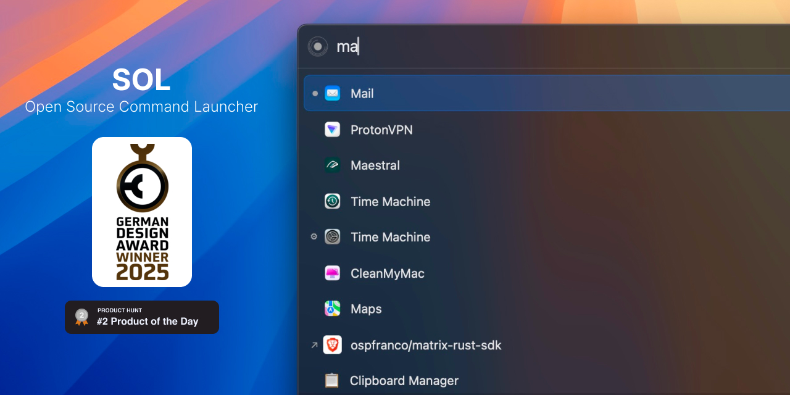

# Sol



<br/>
<div align="center">
  <a align="center" href="https://twitter.com/ospfranco">
    
  </a>
</div>

Sol is an open source app launcher, focused on ease of use and speed. It has minimal configuration and runs natively.

[Visit official site](https://sol.ospfranco.com)

## Download

Install via brew

```
brew install --cask sol
```

Or manually download the latest [release](https://github.com/ospfranco/sol/tree/main/releases).

## Discord

Join the Discord

https://discord.gg/W9XmqCQCKP

## Features

- App search
- Custom shortcuts
- Google translate
- Calendar
- Show upcoming appointement in Menu Bar
- Custom AppleScript commands
- Custom links
- Imports browser bookmarks
- Window Manager
- Emoji picker with default emoji through [Emoji 17.0](https://unicode.org/Public/17.0.0/emoji/emoji-test.txt), filtered for your macOS version (skin-tone variants are not included)
- Clipboard manager
- Notes Scratchpad
- Retrieve Wi-Fi password
- Show IP address
- Start a google meet
- Switch OS theme
- Process killer
- Generate NanoID
- Generate UUID
- Generate lorem ipsum
- Format and paste JSON
- Forward media keys to Spotify/Apple Music
- Blacken Menu Bar
- Quickly evaluate math operations
- Script Runner
- Symbolic Link Support

## Emoji compatibility

Sol keeps its macOS 14.0 minimum and shows only emoji supported by the installed macOS version.
Newer entries carry a minimum macOS version in the bundled catalog:

| Emoji additions | Minimum macOS |
| --- | --- |
| Through Emoji 15.0 | 14.0 (Sol's minimum) |
| Emoji 15.1 | [14.4](https://support.apple.com/en-us/109035) |
| Emoji 16.0 | [15.4](https://support.apple.com/en-us/120283) |
| Emoji 17.0 | [26.4](https://support.apple.com/en-us/122868) |

Version checks compare numeric components and accept later releases automatically; no annual compatibility update is required for existing entries.
Unsupported emoji are excluded from browsing, search, and the seven-entry favorites row, but their saved usage counts are retained.
When those emoji become supported after an OS upgrade, they participate in the normal top-seven favorites ranking.

## Contributing

You need to set up your machine for macOS development with React Native. Basically you need to install:

- Mise (https://mise.jdx.dev/)
- Xcode
- Cocoapods

Follow any of the online tutorials to set up your machine for iOS/MacOS React Native development.

Once you have everything installed run the following commands

```sh
mise plugin add cocoapods
# To enable hooks
mise settings experimental=true
# Will install all bun, ruby and run the installation of dependencies
mise install

# You can then run the app with
bun macos
```

## License

MIT License
